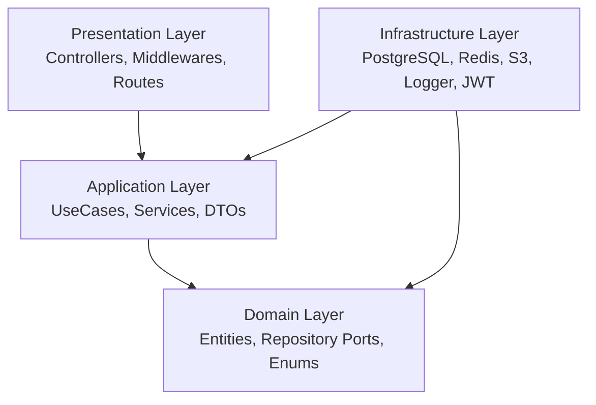

# 🚗 Vanak Backend (ونک - سامانه هوشمند مدیریت و رزرو پارکینگ)

[](https://golang.org)
[](https://gin-gonic.com/)
[](https://www.postgresql.org/)
[](https://redis.io/)
[](https://www.docker.com/)
[](https://swagger.io/)
[](#-architecture--design)

**Vanak Backend** is a high-performance, production-ready RESTful API server powering the **Vanak (VParking)** smart parking management and reservation platform. Designed following **Domain-Driven Design (DDD)** and **Clean Architecture (Hexagonal)** principles in Go.

---

## 📋 Table of Contents

- [Features](#-features)
- [Architecture & Design](#-architecture--design)
- [Tech Stack](#-tech-stack)
- [Directory Structure](#-directory-structure)
- [Prerequisites](#-prerequisites)
- [Environment Configuration](#-environment-configuration)
- [Getting Started](#-getting-started)
  - [1. Running with Docker Compose (Recommended)](#1-running-with-docker-compose-recommended)
  - [2. Running Locally with Go](#2-running-locally-with-go)
- [Database Seeders](#-database-seeders)
- [API Documentation (Swagger)](#-api-documentation-swagger)
- [API Endpoints Overview](#-api-endpoints-overview)
- [CI/CD & Deployment](#-cicd--deployment)
- [Git Contribution Guidelines](#-git-contribution-guidelines)

---

## ✨ Features

- **🔐 Secure Authentication & Authorization**:
  - Passwordless SMS OTP verification with Redis expiration and rate-limiting.
  - Asymmetric RS256 JWT tokens with public/private key pairs.
  - Role-based authorization middlewares.
- **🅿️ Parking Management**:
  - Full CRUD for parking lots, slot allocation, and real-time capacity management.
  - Dynamic pricing (hourly, daily, special days).
  - Geolocation coordinates, Iranian province/city hierarchy, and address handling.
  - Document & image uploads for parking license verification via S3-compatible cloud storage.
- **📅 Smart Slot Reservation**:
  - Real-time availability checks and conflict prevention.
  - Reservation life-cycle management (Pending, Reserved, Completed, Cancelled).
- **🚘 Vehicle Management**:
  - Registered vehicle CRUD linked to user profiles.
  - Support for standardized Iranian license plate formats with custom validation.
- **💳 In-App Wallet & Transactions**:
  - Balance management, mock payment gateway integration, and transaction logs.
- **🌐 Localization & Validation**:
  - Multi-language support (Persian / English) with custom translation middleware.
  - Custom field validators for Iranian phone numbers (`ir_phone`) and postal codes (`ir_postal`).
- **📊 Observability & Diagnostics**:
  - Structured logging with Uber Zap and Lumberjack log rotation.
  - Interactive Swagger / OpenAPI documentation.

---

## 🏛️ Architecture & Design

The backend strictly adheres to **Clean Architecture** (Ports & Adapters) and **DDD**, ensuring separation of concerns, testability, and maintainability:



- **`domain/`**: Enterprise business rules, entities (`User`, `Parking`, `Reservation`, `Vehicle`, `Wallet`, `Address`), enums, custom exceptions, and repository interface ports. Independent of any frameworks or external libraries.
- **`application/`**: Application business rules, service implementations (`ParkingService`, `ReservationService`, `UserService`, `VehicleService`, `WalletService`, `OTPService`, `JWTService`), and DTO request/response contracts.
- **`infrastructure/`**: Adapters for external dependencies: GORM repositories, Unit of Work pattern, PostgreSQL/Redis connections, ArvanCloud/AWS S3 object storage, Zap logger, and JWT key management.
- **`presentation/`**: Gin REST controllers (v1), routing groups, and middlewares (CORS, JWT authentication, panic recovery, error translation).
- **`wire/`**: Compile-time dependency injection using [Google Wire](https://github.com/google/wire).

---

## 🛠️ Tech Stack

| Technology | Purpose |
| :--- | :--- |
| **Go 1.25** | Core Programming Language |
| **Gin-Gonic** | HTTP Web Framework & Router |
| **PostgreSQL 16** | Relational Database |
| **GORM** | Object-Relational Mapping (ORM) & Migrations |
| **Redis 7** | Cache, OTP Session Store, and Rate Limiting |
| **AWS SDK v2 S3** | Cloud Object Storage (ArvanCloud / MinIO) |
| **Google Wire** | Compile-time Dependency Injection |
| **Golang-JWT v5** | RS256 Asymmetric Token Authentication |
| **Uber Zap** | High-performance Structured Logging |
| **Lumberjack** | Log File Rotation |
| **Swaggo / Swag** | Automated Swagger/OpenAPI Documentation |
| **Validator v10** | Request Payload Validation |

---

## 📂 Directory Structure

```
backend/
├── bootstrap/             # App configuration loader and initialization
├── cmd/
│   └── app/
│       └── main.go        # Application entrypoint & HTTP server bootstrap
├── docker/
│   ├── .env               # Docker environment configuration
│   ├── docker-compose.yml # PostgreSQL, Redis, PgAdmin & Backend orchestration
│   └── Dockerfile         # Multi-stage production container build
├── internal/
│   ├── application/       # DTOs, UseCase interfaces, and Service implementations
│   ├── domain/            # Entities, Enums, Filters, and Repository Ports
│   ├── infrastructure/    # GORM repos, DB connections, Redis, S3, Logger, JWT keys, Seeders
│   └── presentation/      # Gin Controllers, Middlewares, and HTTP Routes
├── logs/                  # Application runtime logs (rotated)
├── wire/                  # Google Wire dependency injection declarations
├── .gitlab-ci.yml         # Automated CI/CD pipeline (HamDocker & VPS Deployment)
├── go.mod                 # Go module dependencies
└── README.md              # Project documentation
```

---

## ⚙️ Prerequisites

- **Go**: `1.24+` (recommended: `1.25.x`)
- **Docker & Docker Compose**: `24.0+`
- **PostgreSQL**: `15+` (if running without Docker)
- **Redis**: `7+` (if running without Docker)

---

## 🔐 Environment Configuration

Create a `.env` file in the root directory (or use `docker/.env`):

```env
# Application
APP_PORT=8080
APP_ENV=development

# Database (PostgreSQL)
DB_HOST=127.0.0.1
DB_PORT=5432
DB_USER=postgres
DB_PASSWORD=your_postgres_password
DB_NAME=Vanak
DB_SSLMODE=disable
DB_TIMEZONE=Asia/Tehran

# Redis Cache
REDIS_HOST_CONFIG=127.0.0.1
REDIS_PORT_CONFIG=6379
REDIS_PASSWORD_CONFIG=
REDIS_DB_CONFIG=0

# OTP Settings
OTP_LENGTH=6
OTP_EXPIRY_MINUTES=2
OTP_MAX_ATTEMPTS=3

# JWT
SECRET_KEY=vanakJwtSecretKey

# Object Storage (S3 / ArvanCloud)
BUCKET_REGION=ir-thr-at1
BUCKET_ACCESS_KEY=your_access_key
BUCKET_SECRET_KEY=your_secret_key
BUCKET_ENDPOINT=https://s3.ir-thr-at1.arvanstorage.ir
LOGO_PIC_BUCKET_NAME=vanak-logo-pic
PARKING_PIC_BUCKET_NAME=vanak-parking-pic
PARKING_DOC_BUCKET_NAME=vanak-parking-doc
REGISTRATION_CARD_PIC_BUCKET_NAME=vanak-registration-card-pic

# HashID (Obfuscation)
HASHID_SALT=vanak-parking-salt-secret-key
HASHID_MIN_LENGTH=8

# Logging
LOGGER_FILE_PATH=logs/logs.log
LOGGER_ENCODING=json
LOGGER_LEVEL=debug
LOGGER=zap
```

---

## 🚀 Getting Started

### 1. Running with Docker Compose (Recommended)

To spin up the entire stack (PostgreSQL, Redis, pgAdmin, and Backend):

```bash
cd docker
docker compose up -d --build
```

- **Backend API**: `http://localhost:8080`
- **Swagger Docs**: `http://localhost:8080/swagger/index.html`
- **pgAdmin**: `http://localhost:8090` (User: `mzmadrid@gmail.com`, Pass: `123456`)
- **PostgreSQL**: `localhost:5433` (externally mapped)
- **Redis**: `localhost:6379`

### 2. Running Locally with Go

1. Ensure PostgreSQL and Redis are running locally.
2. Download dependencies:
   ```bash
   go mod download
   ```
3. (Optional) Re-generate Google Wire dependency injection code:
   ```bash
   go install github.com/google/wire/cmd/wire@latest
   cd wire
   wire
   cd ..
   ```
4. Run the application:
   ```bash
   go run cmd/app/main.go
   ```

---

## 🌱 Database Seeders

When the server starts up, it automatically seeds required reference data:
- **Iranian Provinces and Cities** (Tehran, Isfahan, Shiraz, etc.)
- **Parking Attribute Types** (CCTV, Covered, 24/7 Security, EV Charging, Carwash, etc.)
- **Default Test Users and Roles**
- **Sample Parking Facilities** with slots and pricing

Seeders are managed in [`internal/infrastructure/seeder/`](file:///internal/infrastructure/seeder/).

---

## 📖 API Documentation (Swagger)

Interactive OpenAPI / Swagger documentation is integrated and generated with `swaggo`.

- **Access URL**: [http://localhost:8080/swagger/index.html](http://localhost:8080/swagger/index.html)

To regenerate Swagger docs after modifying annotations:
```bash
go install github.com/swaggo/swag/cmd/swag@latest
swag init -g cmd/app/main.go -o internal/infrastructure/swagger/docs
```

---

## 🛣️ API Endpoints Overview

| Method | Endpoint | Description | Auth Required |
| :--- | :--- | :--- | :---: |
| `POST` | `/api/v1/auth/otp/send` | Request OTP code via SMS | No |
| `POST` | `/api/v1/auth/otp/verify` | Verify OTP and receive JWT | No |
| `GET` | `/api/v1/user/profile` | Get current user profile | Yes |
| `PUT` | `/api/v1/user/profile` | Update profile info & avatar | Yes |
| `GET` | `/api/v1/parking` | Search & filter parkings (location, price, amenities) | No |
| `GET` | `/api/v1/parking/:id` | Get parking details and available slots | No |
| `POST` | `/api/v1/parking` | Register new parking (Owner) | Yes |
| `POST` | `/api/v1/reservation` | Book a parking slot | Yes |
| `GET` | `/api/v1/reservation/my` | Get current user's reservations | Yes |
| `POST` | `/api/v1/reservation/:id/cancel` | Cancel an active reservation | Yes |
| `GET` | `/api/v1/vehicle` | List registered vehicles | Yes |
| `POST` | `/api/v1/vehicle` | Register vehicle with Iranian plate | Yes |
| `DELETE` | `/api/v1/vehicle/:id` | Remove a registered vehicle | Yes |
| `GET` | `/api/v1/wallet` | Get wallet balance & transaction history | Yes |
| `POST` | `/api/v1/wallet/topup` | Charge wallet balance (Mock Gateway) | Yes |
| `GET` | `/api/v1/static/provinces` | List provinces & cities | No |
| `GET` | `/api/v1/static/attributes` | List parking amenities | No |

---

## 🔄 CI/CD & Deployment

Automated CI/CD is configured with GitLab CI (`.gitlab-ci.yml`):
- **Build Stage**: Builds a Linux `amd64` Docker image and pushes to `registry.hamdocker.ir`.
- **Deploy Stage**: Pulls the latest image to the production VPS and performs a zero-downtime rolling restart via Docker Compose.
- **Trigger**: Pushes to `main` or commit messages starting with `[deploy]`.

---

## 🤝 Git Contribution Guidelines

### 1. Branch Naming Convention
Branches must be named in **kebab-case**: `<type>/<short-description>`

- `feat/`: New features (e.g., `feat/parking-reservation-api`)
- `fix/`: Bug fixes (e.g., `fix/jwt-expiration-check`)
- `refactor/`: Refactoring code without behavior changes
- `docs/`: Documentation updates
- `test/`: Adding or updating tests
- `chore/`: Build tasks, docker, dependencies

### 2. Semantic Commit Messages
Format: `<type>(<scope>): <subject>`

**Examples:**
- `feat(reservation): add slot collision check`
- `fix(auth): fix redis otp ttl expiration`
- `docs(readme): update backend architecture and endpoints`
- `chore(deps): bump gorm to v1.25.10`
